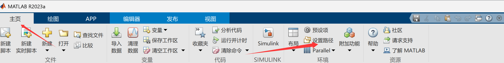
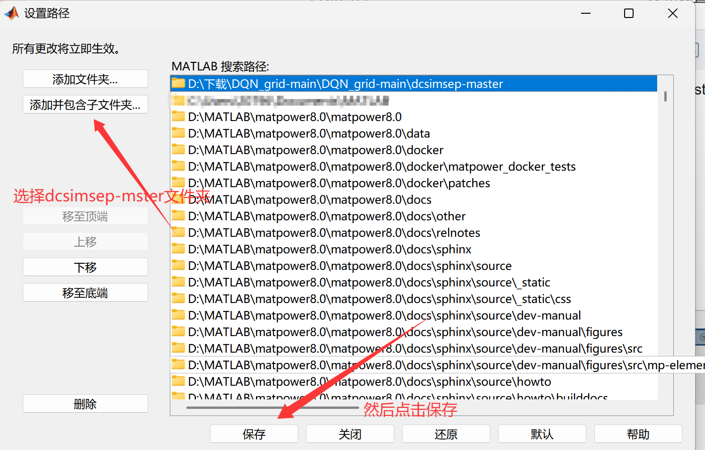

# DCSIMSEP—Power System Chained Fault (Disconnect) DC Power Flow Simulator

The Power System Chained Fault (Disconnect) DC Flow Simulator, developed by Paul Hines at the University of Vermont, with contributions from Eduardo Cotilla-Sanchez, Pooya Rezaei, and Maggie Eppstein.
DCSIMSEP Quick Start Guide:
Navigate to the dcsimsep folder in MATLAB.
Edit and run the setup.m script (for setting paths only)
Navigate to the test directory: input command cd test
Edit and run test_dcsimsep.m to perform the test.
\n        \n  
\nThen run this code for testing:
clc\nclear \naddpath ('dcsimsep-master')\nsetup\nstate=ones(1,41);\nd=[1 2 3];\nTotalGenloss=0;\nsequence=[16 36 6 4 5 29 19 38 39 33];\nfor i=1:length(sequence)\n    [next_state, instant_out, genloss]=attack_eff_IEEE30(state, sequence(i), d);\n    TotalGenloss=genloss+TotalGenloss;\n    state=next_state;\nend\nTotalGenloss\nTotalGenloss/length(sequence)\n  

## Images

<!-- PAYMENT_BLOCK -->

## Get this dataset

- Payment link (Stripe): [Buy now](https://buy.stripe.com/3cs8yP7sY87d0vu9AB)
- Payment QR code: 

<!-- /PAYMENT_BLOCK -->
